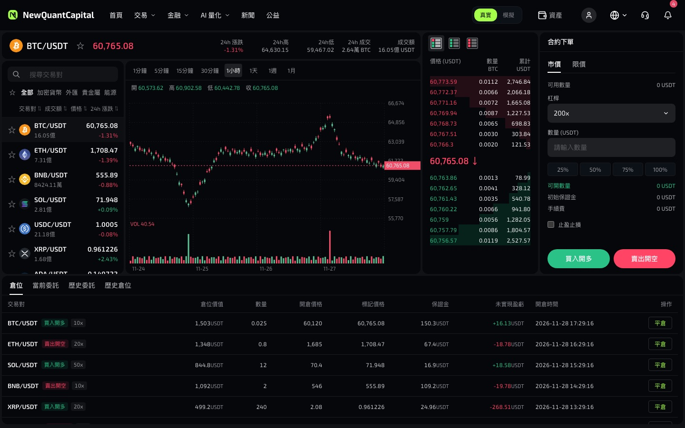
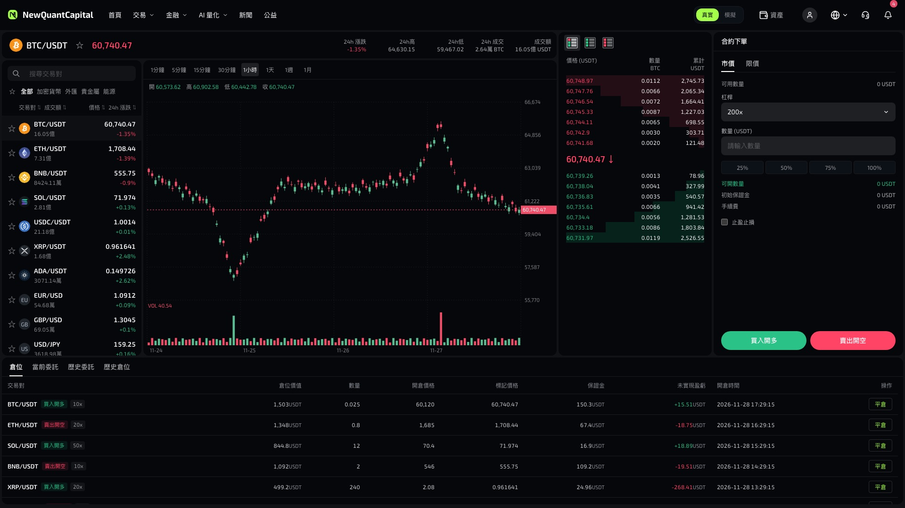
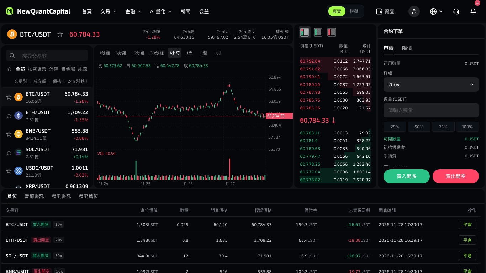
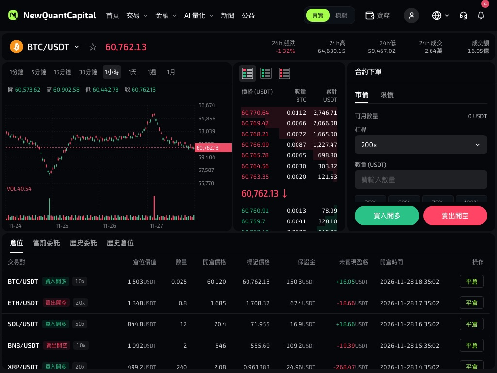
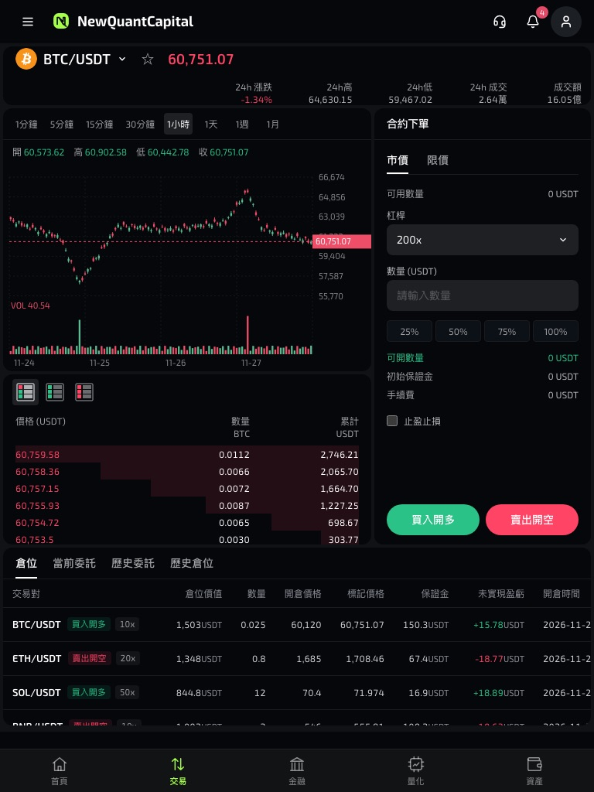
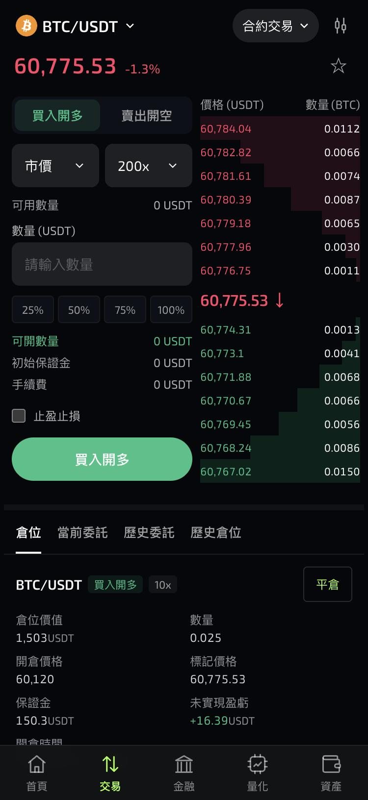

# 交易页不同尺寸展示规则

适用页面：合約交易（`/trade/futures/*`）、二元期權（`/trade/options/*`）、現貨（`/trade/spot/*`）。三个页面布局规则相同，截图以合約交易为例（2026-11-28）。

## 一、断点总览

| 端 | 宽度范围 | 布局要点 |
|---|---|---|
| 手机 | ≤ 767px | App 式紧凑布局：隐藏站点页头，下单表单与订单簿左右并排，记录为卡片，底部标签栏 |
| 竖屏平板 | 768 – 1023px | 原有网格：图表与下单面板并排，订单簿在图表下方，记录通栏；点交易对名称打开左侧交易对抽屉 |
| 横屏平板 | 1024 – 1199px | 三列：信息栏通栏，下面图表 \| 订单簿 \| 下单面板并排，记录区通栏在底部且首屏可见；点交易对名称打开左侧交易对抽屉 |
| PC | ≥ 1200px | 左侧常驻交易对列表 + 图表，订单簿与下单面板顶到页面最上方，记录区通栏在底部 |
| PC 细分 | 1200 – 1599px | 同 PC，顶部 24h 数据间距收窄为 16px；放不下时横向滚动，不换行 |

断点常量：`PAIR_PANEL_QUERY`（1200px）与 `COMPACT_TRADE_QUERY`（767px），见 `newtrend-website/src/composables/useMediaQuery.js`，样式同步在 `styles/trade-workspace.css`。1024px 的横屏平板三列只在样式里切换（组件与竖屏平板相同）。

## 二、PC（≥ 1200px）

### 列宽

| 列 | 内容 | 宽度规则 |
|---|---|---|
| 第 1 列 | 交易对列表 | 16vw，介于 256 – 296px |
| 第 2 列 | 图表（上方为交易对信息栏） | 剩余宽度 |
| 第 3 列 | 订单簿 | 页宽 17%，最少 230px |
| 第 4 列 | 下单面板 | 页宽 21%，最少 300px |

- 顶部信息栏只横跨第 1、2 列；订单簿和下单面板从页面最上方开始，高度到图表底部。
- 记录区（倉位 / 當前委託 / 歷史委託 …）横跨全部 4 列。

### 行高

| 行 | 规则 |
|---|---|
| 信息栏 | 56px（对照参考站 newtrendcapital.com 实测，见下方「顶部信息栏」） |
| 图表行 | 视口高度 − 452px，最小 400px，最大 640px |
| 记录区 | 填满剩余高度（约为屏幕的三分之一），最少 300px，列表在区内滚动 |

### 常见屏幕的实际高度

| 屏幕尺寸 | 图表行 | 记录区 | 一屏能否放下 |
|---|---|---|---|
| 1920×1080 | 628px | 312px | 能 |
| 1440×900 | 448px | 312px | 能 |
| 1366×768 | 400px（最小值） | 300px | 不能，需向下滚动约 72px 才能看到记录区底部 |
| 1200×800 | 400px（最小值） | 300px | 不能，需向下滚动约 40px |

视口高度低于约 840px 时，两者都已是最小值，页面略微滚动。

### 交易对列表

- 自上而下：搜索框；收藏星标 + 全部 + 交易目录分类（加密貨幣、外匯、貴金屬、能源 …）；可排序表头（交易對 · 成交額 / 價格 · 24h 漲跌）；行内容为星标、币种图标、交易对名称和成交额、最新价和涨跌幅。
- 当前交易对用背景色高亮；点击一行切换交易对，产品类型（合約 / 期權 / 現貨）保持不变。
- 不做参考站里的「合約 / 期權 / 現貨」切换，沿用现有的产品切换。
- 分类标签保持一行，放不下的横向滚动（支持滚轮），右侧渐隐提示。

### 顶部信息栏

- 交易对为纯文字加图标，不可点击（左侧列表就是选择器）。
- 24h 数据靠右对齐，始终一行；最新价和各数值预留固定宽度，价格跳动时右侧数据不移位。
- 24h 成交、成交額只显示数字（如 `2.64萬`、`16.05億`），不带币种或 USDT 单位。
- 尺寸对照参考站（2026-11-28 只读实测，1440px）：

| 项目 | 参考站 | 我们 |
|---|---|---|
| 信息栏高度 | 56px | 56px（原 64px） |
| 左右内边距 | 12px（栏宽 ≥ 768px 时 16px） | 12px |
| 交易对 / 最新价 | 18/28，粗体 / 半粗 | 18/28，600 |
| 币种图标 | 28px | 28px |
| 收藏按钮 | 24×24（图标 16px） | 28×32（星标 16px；触屏 44px） |
| 24h 数据 | 标签 12/16 + 数值 12/16，间距 0，块高 32px | 相同（原标签下方有 4px 间距，块高 36px） |
| 数据间距 | 10px（栏宽 ≥ 768px 时 16px） | 24px；1200 – 1599px 为 16px |

平板同样使用 56px 信息栏；手机顶部不变。

## 三、平板（768 – 1199px）

两个平板区间的交易对选择相同：信息栏里的交易对名称带下拉箭头，点击打开左侧交易对抽屉（与手机共用）。24h 数据与 PC 一样靠右对齐、各项预留固定宽度，切换交易对（名称长短不同）时位置不变；竖屏放不下时换到第二行，仍靠右。合約、二元期權、現貨三页规则一致（現貨早已不再有单独的平板网格和行情列表，选交易对一律通过抽屉）。

### 横屏平板（1024 – 1199px，2026-11-28「横屏平板用三列」）

即 PC 布局去掉左侧交易对列表。

| 区域 | 规则 |
|---|---|
| 信息栏 | 通栏，56px |
| 第 1 列 | 图表，剩余宽度 |
| 第 2 列 | 订单簿，230px |
| 第 3 列 | 下单面板，页宽 30%，最少 300px；字段在面板内滚动，買入 / 賣出按钮固定在底部 |
| 图表行高 | 视口高度 − 420px，最小 320px，最大 560px |
| 记录区 | 通栏，最少 260px，填满剩余高度（常见尺寸约 280px），列表在区内滚动 |

| 屏幕尺寸 | 图表行 | 记录区 | 一屏能否放下 |
|---|---|---|---|
| 1024×768 | 348px | 280px | 能 |
| 1100×800 | 380px | 280px | 能 |
| 1180×820 | 400px | 280px | 能 |

视口高度低于约 740px 时图表行停在最小值，记录区开始变矮；低于约 720px（记录区到 260px）页面才略微滚动。

### 竖屏平板（768 – 1023px，保持不变）

竖屏平板与手机一样显示顶部菜单按钮和底部标签栏。

| 区域 | 规则 |
|---|---|
| 图表 | 左列第 1 行 |
| 下单面板 | 右列（页宽 32%，最少 280px），纵跨第 1 – 2 行 |
| 订单簿 | 左列第 2 行，图表下方 |
| 记录区 | 通栏在最下方（1023×768 时首屏只露出标签行，需向下滚动） |

## 四、手机（≤ 767px）

| 区域 | 规则 |
|---|---|
| 站点页头 | 隐藏 |
| 顶部 | 两行：交易对选择（点击打开左侧抽屉）+ 帳戶標識（真實 / 模擬，点击确认后切换）；右侧为产品切换（底部弹层）和 K 线按钮；下一行为最新价、涨跌幅和收藏星标 |
| 图表 | 不在交易页内显示，点 K 线按钮进入单独的图表页 |
| 下单表单 | 左侧；合約先选「買入開多 / 賣出開空」，只显示该方向一个按钮 |
| 订单簿 | 右侧，买卖各固定 7 档，不显示累计列；点价格自动填入限价 |
| 记录区 | 每条记录一张卡片，页面整体滚动 |
| 底部 | 固定标签栏（首頁 / 交易 / 金融 / 量化 / 資產） |

## 五、其他通用规则

- 订单簿在平板与 PC 上单元格不换行；累計（USDT）≥ 1 显示 2 位小数，< 1 最多 4 位，更小显示 `<0.0001`。
- 粗指针（触屏）设备：周期按钮、记录标签、订单簿控制按钮最小 44px。
- 选中与焦点不使用描边或外发光，只用背景色、字重或下划线区分。
