# 交易面板产品文档

版本：2026-11-28 · 适用：新版前台（NewQuantCapital）交易频道
页面：合約交易 `/trade/futures/:交易对`、二元期權 `/trade/options/:交易对`、現貨 `/trade/spot/:交易对`

> 说明：当前为前端原型，行情、余额、委托与记录均为页面内模拟数据，刷新后恢复初始状态，不连接真实撮合与资金。各尺寸布局的详细数值见《交易页不同尺寸展示规则》（`docs/designs/2026-11-28-trading-responsive-layout.md`）。

---

## 1. 产品概览

| 产品 | 入口名称 | 交易方式 | 计价 |
|---|---|---|---|
| 合約交易 | 交易 → 合約交易 | 选择杠杆开多 / 开空，市价或限价，可设止盈止损，手动平仓 | USDT |
| 二元期權 | 交易 → 二元期權 | 预测周期结束时价格涨或跌，到期按收益率自动结算 | USDT |
| 現貨 | 交易 → 現貨 | 用 USDT 买入币种，或卖出持有的币种，市价或限价 | USDT / 币种 |

三个产品共用同一套页面结构，切换产品时保留各自的下单草稿和页面状态。

**交易对分类：** 加密貨幣、外匯、貴金屬、能源。加密货币交易对以 `/USDT` 计价。

**账户：** 页头的「真實 / 模擬」切换决定使用哪个账户。两个账户的余额、委托和记录完全独立；模擬账户有预置余额，可直接体验下单。

---

## 2. 页面结构（PC）

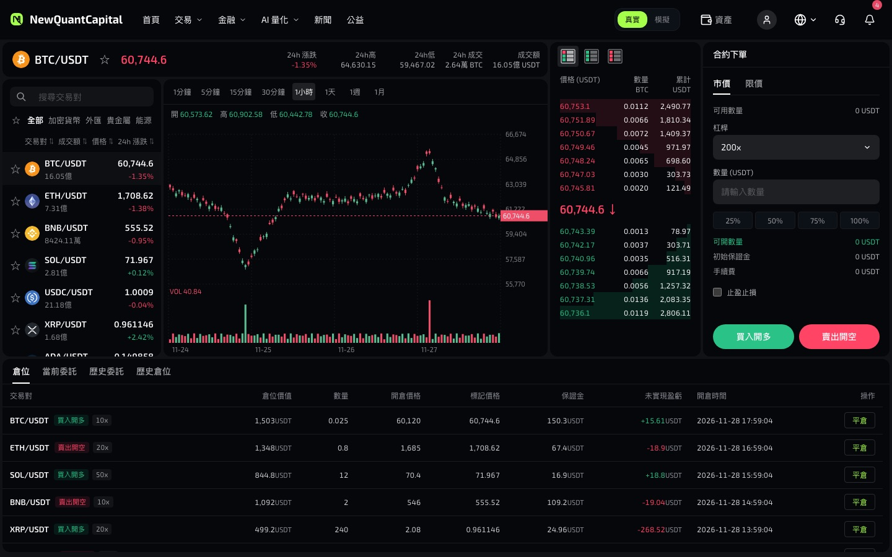

| 编号 | 区域 | 说明 |
|---|---|---|
| ① | 顶部信息栏 | 交易对、收藏星标、最新价；右侧为 24h 漲跌、24h 高、24h 低、24h 成交、成交額 |
| ② | 交易对列表 | 搜索、收藏 / 分类筛选、可排序列表，点击切换交易对 |
| ③ | K 线图 | 周期 1分鐘 – 1月，显示开高低收与成交量 |
| ④ | 订单簿 | 卖盘（红）在上、买盘（绿）在下，中间为最新价；可切换只看买盘 / 只看卖盘 |
| ⑤ | 下单面板 | 随产品不同，见第 3 节 |
| ⑥ | 记录区 | 当前与历史委托 / 仓位 / 订单，见第 4 节 |

### 2.1 顶部信息栏

- 最新价随行情实时跳动，涨为绿、跌为红。
- 收藏星标与交易对列表、手机端抽屉共用同一个收藏列表。
- 24h 数据始终一行显示，空间不足时横向滚动，不换行。

### 2.2 交易对列表

- 搜索：按交易对名称过滤。
- 筛选：收藏（星标）、全部、加密貨幣、外匯、貴金屬、能源。
- 排序：点击「交易對 / 成交額 / 價格 / 24h 漲跌」表头切换升降序。
- 每行显示：收藏星标、图标、交易对名称、成交额、最新价、24h 涨跌幅。当前交易对有背景高亮。
- 点击一行切换交易对，产品类型保持不变（例如在二元期權页点 ETH/USDT，进入 ETH/USDT 的二元期權）。

### 2.3 订单簿

- 每档显示价格、数量、累計（USDT）。背景条长度表示从最新价累计到该档的挂单量占比。
- 行情每秒推送更新。
- 手机端点击某档价格，自动填入限价并切换为限价单（合約、現貨）。

---

## 3. 下单面板

### 3.1 合約交易

| 字段 | 说明 |
|---|---|
| 委托类型 | 市價 / 限價；限價需填写价格 |
| 可用數量 | 当前账户可用 USDT |
| 槓桿 | 1x、25x、50x … 200x |
| 數量（USDT） | 下单名义金额，可点 25% / 50% / 75% / 100% 按可开数量快速填写 |
| 可開數量 | 按当前杠杆与余额可开的最大数量 |
| 初始保證金 | 數量 ÷ 杠杆 |
| 手續費 | 名义金额 × 0.05% |
| 止盈止損 | 勾选后可填写止盈价、止损价 |
| 操作 | PC 同时显示「買入開多」「賣出開空」；手机先选方向，只显示该方向一个按钮 |

下单锁定保证金（市价单含手续费）；平仓返还保证金 + 盈亏 − 平仓手续费。

### 3.2 二元期權

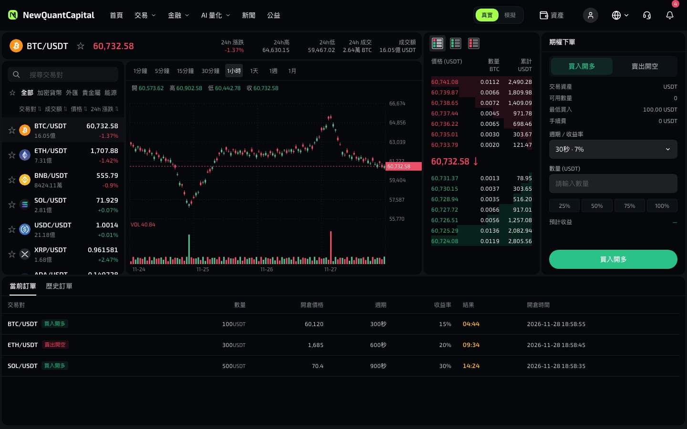

| 字段 | 说明 |
|---|---|
| 方向 | 買入開多（看涨）/ 賣出開空（看跌） |
| 交易資產 | USDT |
| 可用數量 | 当前账户可用 USDT |
| 最低買入 | 100 USDT |
| 週期 / 收益率 | 30秒 7%、60秒 15%、120秒 20%、1天 30%、2天 35%、4天 40%、7天 50%、15天 60% |
| 數量（USDT） | 投入金额，可按比例快速填写 |
| 預計收益 | 數量 × 收益率 |

**结算规则：** 周期结束时以最新价判断。

| 结果 | 条件 | 资金 |
|---|---|---|
| 贏 | 方向判断正确 | 返还本金 + 本金 × 收益率 |
| 輸 | 方向判断错误 | 返还本金 − 本金 × 收益率 |
| 平 | 价格不变 | 返还本金 |

**下单流程：**

1. 点下单按钮，弹出确认框，显示数量、价格、周期和收益率。

   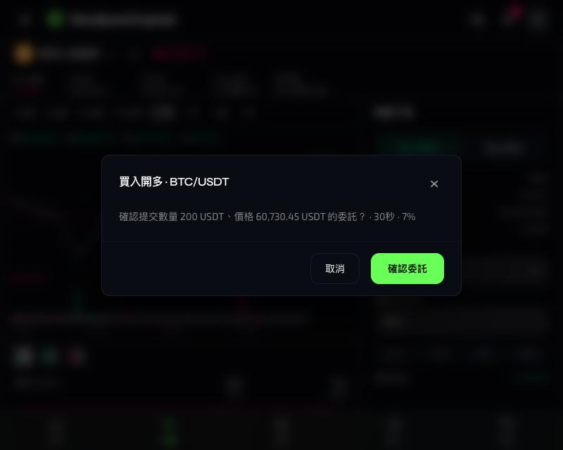

2. 确认后弹出订单窗口，显示「下單成功」和倒计时圆环，以及数量、开仓价格、周期、收益率、订单 ID（可复制）、开仓时间。

   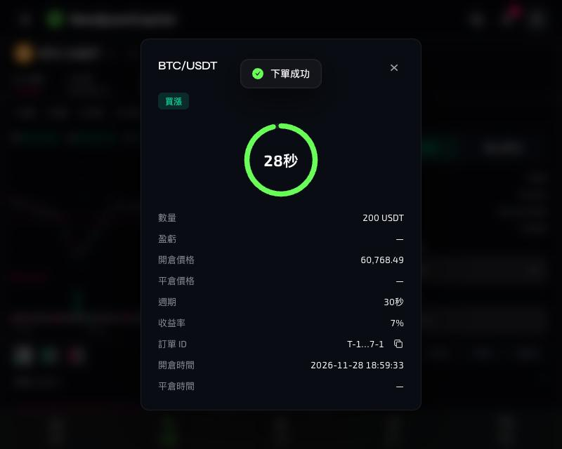

3. 周期结束后，窗口内显示结果标签（贏 / 輸 / 平）、盈亏、平仓价格和平仓时间。提前关闭窗口不影响结算，记录区会在到期时自动刷新。

   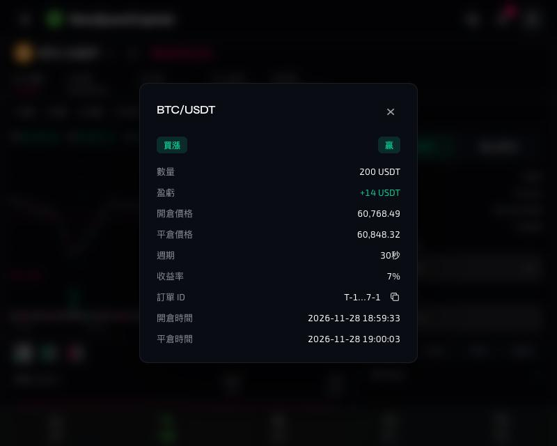

### 3.3 現貨

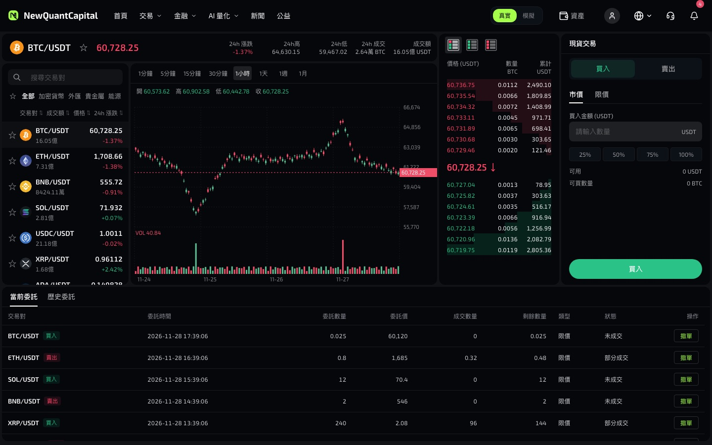

| 字段 | 说明 |
|---|---|
| 方向 | 買入 / 賣出 |
| 委托类型 | 市價 / 限價 |
| 買入金額（USDT） | 买入时按 USDT 金额下单 |
| 賣出數量（币种） | 卖出时按持有的币种数量下单 |
| 比例快捷 | 25% / 50% / 75% / 100% |
| 可用 / 可買數量 | 买入时显示可用 USDT 和可买到的币种数量；卖出时显示可卖数量 |

买入锁定金额 + 手续费，成交后到账币种；卖出锁定币种，成交后到账 USDT（扣除手续费）。买卖两边草稿互不影响。

### 3.4 下单校验与提示

- 未登录：提示「請先登入本地演示帳戶」。
- 行情未连接或已过期：暂停下单，提示「行情尚未連線，暫時無法下單，請稍後再試。」，信息栏显示连接状态，恢复后自动重连。
- 余额不足、数量低于最低值、限价未填等：toast 提示，表单内容保留。
- 每次下单都有确认框；提交过程中按钮不可重复点击。

---

## 4. 记录区

| 产品 | 标签 | 主要字段 | 操作 |
|---|---|---|---|
| 合約交易 | 倉位 / 當前委託 / 歷史委託 / 歷史倉位 | 仓位价值、数量、开仓价格、标记价格、保证金、未实现盈亏、开仓时间 | 平倉、撤單 |
| 二元期權 | 當前訂單 / 歷史訂單 | 数量、开仓价格、（平仓价格）、周期、收益率、结果、（盈亏）、开仓时间、（平仓时间） | — |
| 現貨 | 當前委託 / 歷史委託 | 委托时间、委托数量、委托价、成交数量、剩余数量、类型、状态 | 撤單 |

- 二元期權的「結果」列：进行中显示黄色倒计时（不足 1 分钟显示「秒」，之后为 mm:ss / hh:mm:ss / 天）；结束后显示贏 / 輸 / 平。
- 平倉、撤單都有确认框，默认焦点在「取消」；确认后记录移入对应历史，重复确认不会生成重复记录。部分成交的委托撤单时只撤剩余部分。
- 未实现盈亏按实时行情计算，盈为绿、亏为红。
- 历史列表每页 10 条（手机端滚动加载）。

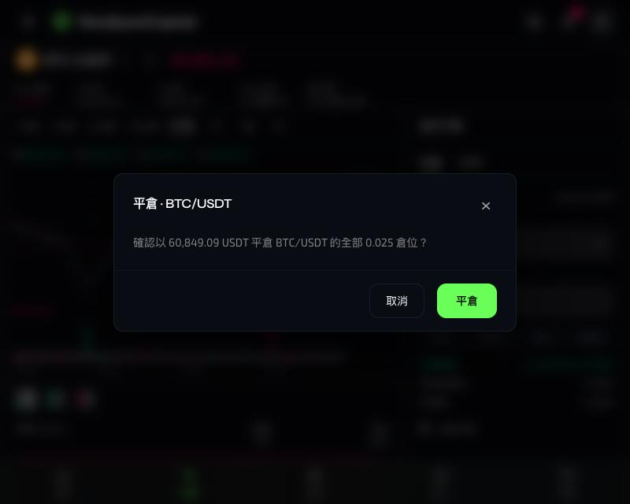

---

## 5. 手机端

<table>
<tr>
<td>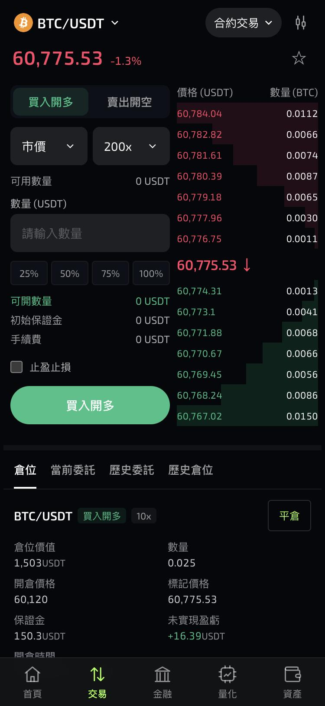</td>
<td>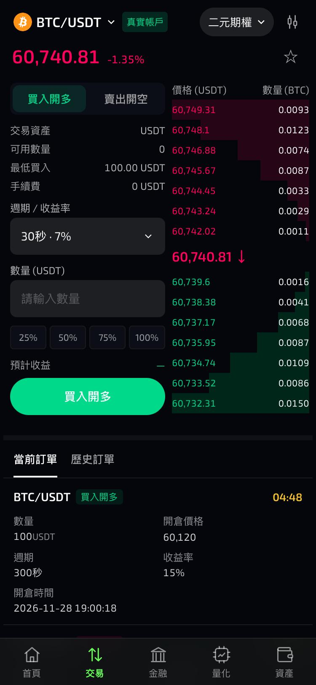</td>
<td>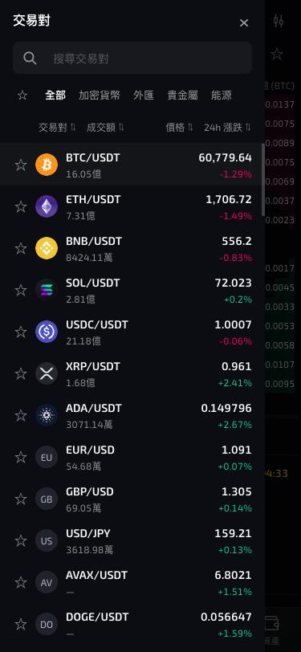</td>
<td>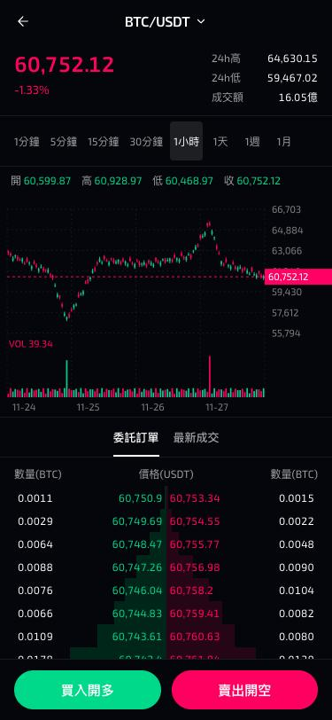</td>
</tr>
<tr><td>合約交易</td><td>二元期權</td><td>交易对抽屉</td><td>K 线页</td></tr>
</table>

| 区域 | 说明 |
|---|---|
| 顶部 | 交易对（点击打开左侧交易对抽屉）、账户标识（真實帳戶 / 模擬帳戶，点击确认后切换）、产品切换（底部弹层）、K 线按钮；下一行为最新价、涨跌幅、收藏 |
| 下单与订单簿 | 表单在左、订单簿在右（买卖各 7 档）；点击档位价格填入限价 |
| K 线页 | 独立页面：返回、交易对、价格和 24h 数据、K 线、委託訂單 / 最新成交，底部固定「買入開多 / 賣出開空」，点击返回交易页并选中该方向 |
| 记录 | 每条记录一张卡片，二元期權倒计时 / 结果显示在卡片右上角 |
| 导航 | 隐藏站点页头，底部固定标签栏（首頁 / 交易 / 金融 / 量化 / 資產） |
| 交易对抽屉 | 与 PC 交易对列表同一套功能：搜索、收藏 / 分类、排序；点击空白处可关闭 |

---

## 6. 交互约定

- 产品切换、交易对切换都保留各产品的下单草稿与页面状态。
- 收藏保存在本机浏览器，刷新和切换产品后保留。
- 选中、焦点状态不使用描边，只用背景色、字重或下划线区分。
- 所有操作结果（成功、失败、校验）都用 toast 提示。
- 弹窗不能通过点击遮罩关闭；只有手机端的交易对抽屉和产品切换弹层这类纯选择器可以点空白处关闭。
